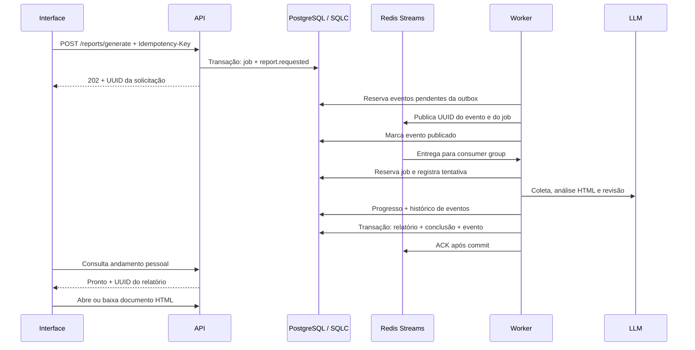

# Relatórios assíncronos e documentos HTML

A geração de relatórios usa eventos persistidos no PostgreSQL e um gateway Redis Streams. A API registra a solicitação e responde `202 Accepted`; um worker coleta as evidências, chama a LLM, revisa o conteúdo e salva o HTML. Fechar a tela, perder o WebSocket ou sair da sessão não cancela uma solicitação já registrada.

## Fluxo e contratos



O gateway está em `gateway/queue/redis`, por trás de `report.EventQueue`. As portas de solicitações, execução e outbox ficam em `domain/usecase/report`. O adapter SQLC fica em `gateway/postgres/repository/reportjob`, separado em constructor, operações e mapper. Os comandos SQL estão em `queries/report_job.sql`; a migration `008_async_report_jobs.sql` acrescenta as tabelas sem alterar relatórios existentes.

Redis Streams fornece consumer groups, confirmações e recuperação de mensagens pendentes; a entrega pode se repetir. Isso é tratado pelo estado e pelos tokens de reserva no banco. Veja [consumer groups](https://redis.io/docs/latest/commands/xreadgroup/) e [recuperação com XAUTOCLAIM](https://redis.io/docs/latest/commands/xautoclaim/).

## Persistência e recuperação

- `report_jobs` guarda proprietário, pedido, chave de idempotência, estado, tentativas, próxima execução, reserva do worker, progresso, falha e relatório resultante.
- `report_events` guarda o histórico das etapas. Eventos `report.requested` também são a outbox: só são marcados como publicados depois que o Redis aceita a mensagem. Prompts e snapshots ficam no PostgreSQL; a fila transporta apenas UUIDs e o tipo do evento.
- Criação da solicitação e do evento ocorre numa transação. Se o Redis estiver fora do ar, o pedido continua registrado na fila do usuário; o publicador volta a tentar.
- `Idempotency-Key` é um UUID gerado pelo cliente. Repetir a mesma chave e o mesmo pedido retorna a solicitação existente. A mesma chave com outro pedido gera conflito. Um índice limita cada usuário a uma solicitação ativa, inclusive entre processos.
- Uma reserva tem token e prazo, de `AI_REPORT_TIMEOUT + 30s`. O prazo limita cada tentativa; os tokens impedem um worker antigo de atualizar ou concluir o trabalho depois de uma retomada.
- O worker tenta até três vezes. Falhas usam espera de 5 e 20 segundos antes das próximas tentativas. Falha definitiva fica visível; **Tentar novamente** cria outra solicitação, preservando o histórico da anterior.
- A recuperação revisa reservas expiradas e republica pedidos que continuam na fila há mais de 60 segundos. Assim, perder dados do Redis não apaga pedidos do PostgreSQL. Uma mensagem duplicada não repete uma tentativa que já está reservada ou concluída.
- O UUID do relatório é o UUID da solicitação. Documento, conclusão e evento final são confirmados juntos, antes do ACK. Uma queda depois da chamada à LLM e antes do commit pode exigir uma nova chamada.

O Redis do Compose usa volume e AOF com `appendfsync everysec`. Essa política pode perder escritas recentes numa queda; por isso a recuperação também consulta o PostgreSQL. Veja [persistência Redis](https://redis.io/docs/latest/operate/oss_and_stack/management/persistence/).

## Documento HTML

A análise e a revisão da LLM preenchem os componentes estruturados em português: título, resumo, métricas, seções, gráficos com pontos numéricos, tabelas, recomendações e limitações. O gateway `reporthtml` monta um documento editorial com identidade visual, cards, tabelas responsivas e SVGs reais calculados a partir dos pontos. Os gráficos têm borda sólida e preenchimento translúcido, valores negativos/zero são suportados e os dados podem ser conferidos em uma tabela acessível. O HTML complementar da LLM fica disponível em uma seção expansível; nenhuma biblioteca ou JavaScript é necessário no artefato. `content.html` salvo contém o documento final completo. Exportar novamente não duplica o tema, o conteúdo nem as limitações.

`gateway/reporthtml` limita o documento a 1 MiB e aplica uma lista de elementos/atributos permitidos. Preserva CSS e SVG; remove scripts, handlers `on*`, formulários, iframes, base, meta refresh e referências externas em links/imagens. Uma CSP inserida no próprio documento bloqueia scripts, conexões e recursos externos, inclusive ao abrir o arquivo exportado. Limitações registradas durante a coleta são acrescentadas ao documento mesmo se não aparecerem no layout da LLM. A resposta HTTP também aplica CSP, `nosniff`, `no-referrer` e cache privado.

A interface usa um `iframe` com `sandbox` vazio, sem permissão de scripts ou mesma origem. Não insere o HTML na árvore DOM da aplicação. Os controles da interface continuam usando PrimeVue e Heroicons; o artefato HTML é independente de Vue, bibliotecas externas e do servidor.

**Apresentar** abre o documento em um dialog amplo e maximizável. **Baixar HTML** salva o documento independente, pronto para abrir no navegador e imprimir, inclusive como PDF pelo diálogo de impressão. **Baixar JSON** continua disponível com o snapshot das evidências. Relatórios antigos continuam disponíveis. Ao exportar, os componentes estruturados existentes podem receber o novo layout; não se inventam pontos para gráficos que a LLM não forneceu. Nesse caso, gere um novo relatório para obter os gráficos com o novo contrato de apresentação.

O dashboard mostra a análise pessoal mais recente, com abertura no próprio dashboard. Na tela Relatórios, a aba **Relatórios com IA** concentra a criação e o histórico. As solicitações mostram estado, tentativas, etapas e opções de abrir ou reenviar. Um acompanhamento global consulta o andamento a cada 2,5 segundos enquanto há trabalho ativo e a cada 15 segundos quando não há; a conclusão gera toast enquanto o sistema está aberto. Recarregar ou reabrir a aplicação recupera o estado do banco. As consultas continuam restritas ao proprietário; o histórico lista metadados sem carregar os documentos HTML de todos os relatórios.

O layout e os SVGs são gerados pelo backend, mas os valores estruturados e a análise da LLM ainda não têm garantia de exatidão. O prompt exige conferir as contagens, o recorte e a soma das distribuições contra as demandas consultadas. Escopo, fontes e estrutura continuam validados, e os indicadores fixos do sistema continuam calculados em Go. Os testes da integração OpenAI usam respostas simuladas.

## Executar

No ambiente completo:

```bash
docker compose up -d --build
```

O Compose executa `api` e `worker` em containers separados, além de PostgreSQL, Redis e frontend. Redis fica na rede interna. Ambos os processos recebem a configuração do banco e da OpenAI. Sem `OPENAI_API_KEY`, as demais funções continuam disponíveis, e a geração com IA permanece desabilitada.

No desenvolvimento local:

```bash
docker compose -f docker-compose.dev.yaml up -d db redis
# Com as variáveis do .env.example configuradas:
cd backend && go run ./cmd/api
```

Use a raiz do projeto para carregar o `.env` automaticamente, ou exporte as variáveis antes de executar a partir de `backend`. O Compose de desenvolvimento publica Redis apenas em `127.0.0.1:6379`. `PROCESS_ROLE=all` executa API e worker no mesmo processo durante o desenvolvimento; `api` e `worker` separam as responsabilidades.

| Variável | Padrão | Uso |
|---|---|---|
| `PROCESS_ROLE` | `all` | `api`, `worker` ou `all` |
| `REDIS_URL` | `redis://localhost:6379/0` | Conexão; aceita `rediss://` |
| `REPORT_QUEUE_STREAM` | `squadflow:reports` | Stream dedicado a relatórios |
| `REPORT_QUEUE_GROUP` | `report-workers` | Um consumer group por stream dedicado |
| `REPORT_WORKER_CONCURRENCY` | `2` | Gerações simultâneas por processo worker, entre 1 e 16 |
| `OPENAI_STORE_RESPONSES` | `false` | `true` habilita o armazenamento de inputs/outputs da Responses API para inspeção na plataforma OpenAI |
| `AI_REPORT_TIMEOUT` | `210s` | Prazo total de uma tentativa, incluindo todas as chamadas à OpenAI |
| `SERVER_WRITE_TIMEOUT` | `30s` | Escritas HTTP; não precisa superar a duração da LLM |

O cliente OpenAI não define um timeout HTTP total próprio: cada chamada respeita o contexto do worker e o tempo restante de `AI_REPORT_TIMEOUT`. Esse limite é independente de `SERVER_WRITE_TIMEOUT`, pois a geração acontece fora da requisição HTTP da API.

As instâncias worker do mesmo ambiente devem compartilhar stream e grupo. O gateway confirma e remove mensagens processadas do stream dedicado; não se deve reutilizá-lo com outros consumer groups. O histórico permanente fica no PostgreSQL. Reinicie API e worker após alterar a configuração do provedor.

## API

| Método | Endpoint | Resultado |
|---|---|---|
| POST | `/api/v1/reports/generate` | `202`, job e `Location`; aceita `Idempotency-Key` |
| GET | `/api/v1/reports/jobs` | Últimas 50 solicitações pessoais |
| GET | `/api/v1/reports/jobs/{id}` | Job com histórico de eventos |
| POST | `/api/v1/reports/jobs/{id}/retry` | Outra solicitação para um job com falha |
| GET | `/api/v1/reports` | Metadados dos relatórios pessoais, sem HTML/snapshot |
| GET | `/api/v1/reports/{id}` | Relatório completo, HTML e evidências |
| GET | `/api/v1/reports/{id}/html` | Documento HTML isolado |
| GET | `/api/v1/reports/{id}/html?download=1` | Download do HTML |

O WebSocket aceita `report.generate` com o pedido e um `request_id` de correlação, além de `idempotency_key` opcional, e devolve `report.queued`. A execução não pertence à conexão. O frontend usa HTTP para solicitar e consultar o estado persistido; as atualizações normais do workspace continuam no WebSocket.

## Verificação

```bash
make sqlc-check
make lint
make test # requer Docker; PostgreSQL e Redis via Testcontainers
cd frontend
npm run build
E2E_EMAIL='admin-de-teste@example.com' E2E_PASSWORD='senha-de-teste' npm run test:e2e
```

Os testes cobrem criação sem chamar a LLM, idempotência, propriedade, reserva concorrente, duplicidade, indisponibilidade do broker, recuperação de lease, limite de tentativas, retomada após desconexão, isolamento HTML, histórico, apresentação, download e abertura no dashboard. Cada teste recebe contêineres descartáveis próprios, com portas dinâmicas e limpeza automática. A tag `integration` separa essa suíte dos testes unitários. Veja [TESTING.md](TESTING.md).

## Tela de relatórios

As abas PrimeVue dividem as informações em **Visão geral**, **Fluxo e qualidade**, **OS e equipe** e **Relatórios com IA**. Todos os indicadores anteriores permanecem disponíveis. Status e prioridade usam as agregações reais do backend; os gráficos de QA e atenção ao prazo esclarecem o que está sendo contado. Um item pode estar vencido e sem responsável, então esses grupos não são somados. A aba fica em `?tab=overview|flow|team|ai`; links com `report_id` ou `demand_id` abrem a análise de IA. Alternar entre abas preserva o pedido em edição.

## Logs da OpenAI

Por padrão enviamos `store: false`. Para inspecionar novas chamadas no dashboard da OpenAI, configure `OPENAI_STORE_RESPONSES=true` e recrie API e worker. A opção permite armazenar na OpenAI o conteúdo de entrada e saída; não publica retroativamente chamadas antigas. Verifique o projeto correspondente à chave e os filtros da plataforma. Cada chamada leva `metadata.application=squadflow`, `metadata.report_job_id` e `metadata.agent`; os mesmos identificadores e os request/response IDs aparecem nos logs locais do worker. Isso é observabilidade da Responses API, não uma integração com o tracing do Agents SDK. Veja a [documentação oficial de armazenamento de respostas](https://developers.openai.com/api/docs/guides/migrate-to-responses).
