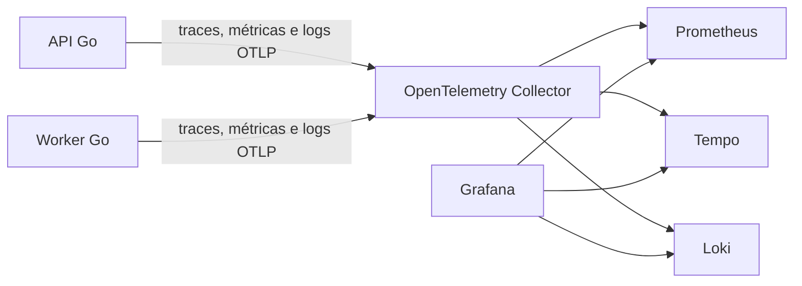

# Observabilidade com OpenTelemetry

O backend exporta **traces, métricas e logs por OTLP HTTP/protobuf**. O gateway `internal/app/gateway/telemetry` concentra SDKs, exporters e instrumentação. O domínio permanece independente dos SDKs; os contratos existentes são decorados na composição.

A exportação é opcional, desabilitada por padrão. Os logs JSON em stdout continuam disponíveis. A configuração local inclui OpenTelemetry Collector, Grafana, Prometheus, Tempo e Loki na imagem fixada `grafana/otel-lgtm:0.37.0`, com um dashboard provisionado do SquadFlow. Essa imagem se destina a desenvolvimento, demonstração e testes, conforme a [documentação oficial](https://github.com/grafana/docker-otel-lgtm).

## Arquitetura



A instrumentação usa os SDKs Go e exporters HTTP oficiais. Há processamento em lote para traces/logs e exportação periódica das métricas. Não existe um endpoint público `/metrics` na aplicação: os dados são enviados ao Collector. Veja [exporters OpenTelemetry Go](https://opentelemetry.io/docs/languages/go/exporters/).

## Ambiente completo

Na raiz, com a `.env` da aplicação já configurada:

```bash
make observability-up
```

Equivale a `OTEL_ENABLED=true docker compose --profile observability up -d --build`. Sobe aplicação e stack local, habilitando a exportação nos processos API e worker. Para manter a exportação habilitada nas próximas execuções comuns do Compose, configure `OTEL_ENABLED=true` na sua `.env`.

- Aplicação: `http://127.0.0.1:8080`.
- Grafana: `http://127.0.0.1:3000`, dashboard **SquadFlow → SquadFlow — Observabilidade**.
- OTLP HTTP local: `http://127.0.0.1:4318`.

Grafana permite consulta anônima como Viewer nesse ambiente local; as credenciais administrativas padrão da imagem são `admin` / `admin`. As portas ficam restritas ao loopback. A stack local não configura autenticação do Collector nem representa uma implantação de produção.

Os dados da stack ficam em `oteldata`, separados dos volumes da aplicação. O perfil sem observabilidade continua funcionando com `OTEL_ENABLED=false`.

## Backend executado fora do Docker

Suba somente a stack local, sem depender da configuração de credenciais da aplicação para o Compose:

```bash
make observability-local
```

Esse comando usa `compose.observability.yaml`. Para iniciar o backend, exporte as variáveis de banco e autenticação necessárias e habilite a telemetria:

```bash
cd backend
OTEL_ENABLED=true OTEL_EXPORTER_OTLP_ENDPOINT=http://127.0.0.1:4318 go run ./cmd/api
```

Se a configuração estiver na `.env` da raiz, lembre que `godotenv.Load()` procura o arquivo no diretório de execução. Uma alternativa é rodar `go -C backend build -o /tmp/squadflow-api ./cmd/api` e executar o binário a partir da raiz, preservando a leitura da `.env` local.

No Compose completo, o endpoint padrão é `http://otel-lgtm:4318`, na rede interna. Para substituí-lo, use `OTEL_COLLECTOR_ENDPOINT`. A variável `OTEL_EXPORTER_OTLP_ENDPOINT` é usada diretamente pelos processos Go locais. Não inicie as duas configurações da stack ao mesmo tempo nas mesmas portas.

## Configuração

| Variável | Padrão | Uso |
| --- | --- | --- |
| `OTEL_ENABLED` | `false` | Inicializa exportação dos três sinais |
| `OTEL_SERVICE_NAME` | derivado de `PROCESS_ROLE` | `squadflow-api`, `squadflow-worker` ou `squadflow-all`; Compose nomeia API e worker explicitamente |
| `OTEL_EXPORTER_OTLP_ENDPOINT` | `http://localhost:4318` | URL-base OTLP HTTP para execução Go local; caminhos dos sinais são acrescentados pelo gateway |
| `OTEL_COLLECTOR_ENDPOINT` | `http://otel-lgtm:4318` | URL-base aplicada aos containers do backend no Compose completo |
| `OTEL_TRACE_SAMPLE_RATIO` | `1` | Probabilidade de amostragem de traces raiz, de 0 a 1; spans filhos seguem a decisão do pai |
| `OTEL_METRIC_INTERVAL` | `15s` | Intervalo de exportação das métricas |
| `LOG_LEVEL` | `info` | `debug`, `info`, `warn` ou `error` |
| `OTEL_EXPORTER_OTLP_HEADERS` | sem headers | Headers de autenticação lidos pelos exporters oficiais, quando configurados no ambiente do processo |

Esta versão configura o sampler `ParentBased(TraceIDRatioBased(...))` por `OTEL_TRACE_SAMPLE_RATIO`. Não interpreta todas as combinações de `OTEL_TRACES_SAMPLER`. O transporte implementado é HTTP/protobuf, e não gRPC. Para um Collector remoto, use URL HTTPS e a configuração de acesso apropriada; as opções de exporter que o gateway define explicitamente prevalecem sobre defaults dos SDKs.

Recurso comum aos sinais: `service.name`, `service.namespace=squadflow`, `service.version`, `deployment.environment.name` e `service.instance.id` único por processo. O gateway preserva o Go 1.24 do projeto.

## Traces HTTP e correlação

O middleware próprio fica em `gateway/api/middleware/observability.go`, depois de RequestID/RequestContext e antes de logger, Recoverer e demais middlewares.

- Extrai `traceparent`/`tracestate` W3C e cria um span de servidor.
- Devolve `X-Trace-Id` quando há um contexto de trace válido. Headers HTTP são insensíveis a maiúsculas/minúsculas.
- Nomeia o span com método e **template da rota**, como `GET /api/v1/demands/{id}`.
- Registra método, rota, status e duração. Rotas desconhecidas usam `unmatched`.
- Marca respostas 5xx como erro, incluindo panics recuperados pelo Chi.
- Exclui `/healthz` e a conexão longa `/api/v1/ws` das medidas de latência HTTP.

Os logs com contexto recebem `trace_id`, `span_id`, request ID e agente quando disponíveis. `response.SendContext` mantém os erros HTTP correlacionados; `response.Send` permanece disponível para chamadas sem contexto de requisição.

## PostgreSQL

O `pgx.QueryTracer` cria spans de cliente para queries, inclusive dentro das transações. Usa o nome da operação SQLC, quando presente, e nomes genéricos para comandos sem essa identificação.

**SQL, parâmetros e DSN não são atributos dos spans.** Erros dos spans recebem classificação limitada, sem copiar a mensagem bruta do banco. Há duração/volume de queries e gauges do pool: conexões totais, adquiridas e ociosas.

A coleta dos gauges usa callback e a inscrição do pool é removida antes de fechá-lo. A instrumentação não muda o SQL nem as fronteiras transacionais da UoW.

## Relatórios, outbox e Redis

A migration `009_observability.sql` acrescenta `trace_parent` e `trace_state` em jobs e eventos. As consultas e os tipos são regenerados pelo SQLC.

1. Ao registrar o pedido, o adapter persiste o contexto do trace junto do job e do evento.
2. Ao reservar a outbox, recupera esse contexto.
3. O decorator da fila cria um span de produtor, injeta o contexto na mensagem Redis e publica.
4. O consumidor extrai o contexto e cria um span de processamento.
5. O decorator do caso de uso cria `report.build`; as chamadas ao provedor aparecem como filhos.
6. Novas tentativas e recuperação preservam um contexto persistido mesmo depois de terminar a requisição original.

Os campos internos de contexto têm `json:"-"` e não são devolvidos nos recursos da API. Não se propaga baggage; o tamanho de tracestate é limitado para que metadados opcionais não inviabilizem a gravação do job.

Repetir uma chave idempotente recupera o job e seu contexto original. O trace da consulta posterior ou da segunda requisição HTTP é próprio dessa nova requisição; ele não substitui a origem persistida do trabalho.

O span de processamento representa o tratamento da mensagem. Quando uma falha de geração é persistida para nova tentativa, o tratamento pode terminar sem erro de transporte; `report.build` e os contadores de resultado mostram a falha de geração separadamente.

## LLM

Cada chamada cria `openai.responses`, com provedor, modelo, etapa e status HTTP, quando disponível. A duração inclui a leitura e validação da resposta. Tokens de entrada/saída são as contagens informadas pelo provedor, sem estimativa de preço.

Não há captura automática de prompt, evidências, resposta gerada, corpo HTTP, chave, cookies ou headers de autenticação. Os logs manuais da aplicação continuam sendo conteúdo da aplicação e precisam seguir a política de dados do ambiente em que forem exportados.

A exportação OTLP é observabilidade da aplicação, distinta do armazenamento de Responses na OpenAI. `OPENAI_STORE_RESPONSES` continua controlando somente o comportamento do provedor. O contexto do worker continua sendo o prazo da geração.

## Métricas disponíveis

Nomes abaixo são os nomes após tradução OTLP no Prometheus local:

| Série / família | Significado |
| --- | --- |
| `squadflow_http_server_operations_total` | Requisições por método, rota, status e resultado |
| `squadflow_http_server_duration_seconds_*` | Histograma de duração HTTP |
| `squadflow_db_query_operations_total` | Operações de query por resultado |
| `squadflow_db_query_duration_seconds_*` | Histograma de duração das queries |
| `squadflow_db_pool_connections`, `_acquired`, `_idle` | Uso do pool PostgreSQL |
| `squadflow_queue_operations_total` | Publicações e mensagens tratadas, por operação e resultado |
| `squadflow_queue_duration_seconds_*` | Duração de publicação/processamento |
| `squadflow_report_build_operations_total` | Construções de relatório por resultado |
| `squadflow_report_build_duration_seconds_*` | Duração da construção de conteúdo |
| `squadflow_report_jobs_total` | Conclusões, novas tentativas e falhas definitivas observadas nos commits de `Complete`/`Fail` |
| `squadflow_llm_request_operations_total` | Chamadas ao modelo por etapa e resultado |
| `squadflow_llm_request_duration_seconds_*` | Duração por etapa de chamada |
| `squadflow_llm_tokens_total` | Tokens por direção (`input`/`output`) |
| `squadflow_runtime_goroutines` | Goroutines no processo |
| `squadflow_runtime_heap_bytes` | Bytes alocados no heap Go |

Não são usados IDs de usuário, demanda, job, trace, mensagem, prompt ou URL bruta como labels de métricas. IDs de job podem existir em atributos de spans para diagnóstico. Os contadores de jobs não são um inventário de estados do banco nem uma medida de backlog; recuperações que encerrem uma reserva sem passar por `Fail` não incrementam esse contador.

## Usar o dashboard

O dashboard provisionado contém volume e 5xx HTTP, p95 por rota, PostgreSQL, LLM, tokens, resultados de jobs, construção de relatórios, fila, heap, goroutines, pool e logs. Os painéis de fila/IA precisam de atividade nesses fluxos.

Para investigar uma solicitação:

1. Faça uma operação e capture o `X-Trace-Id` da resposta original.
2. Abra **Explore → Tempo** e cole o identificador, ou busque `{ resource.service.namespace = "squadflow" }`.
3. Nos logs, use `trace_id` para abrir o trace correspondente.
4. No dashboard, escolha o serviço ou todos os serviços e o período da execução.

Exemplos de consulta:

```promql
sum by (http_route) (
  rate(squadflow_http_server_operations_total[5m])
)
```

```promql
histogram_quantile(0.95,
  sum by (le, http_route) (
    rate(squadflow_http_server_duration_seconds_bucket[5m])
  )
)
```

```logql
{service_namespace="squadflow"} | trace_id = "TRACE_ID_DA_OPERACAO"
```

Um painel vazio não significa necessariamente falha de exportação: confira serviço, período e existência de atividade. Aguarde o intervalo de exportação e ao menos duas amostras para consultas com `rate`. Uma aplicação encerrada deixa de produzir amostras atuais; consulte o intervalo em que o teste executou.

## Falhas, encerramento e limites

Exportação em background tem filas e timeouts próprios. Indisponibilidade do Collector gera aviso local e não deve bloquear a resposta HTTP ou impedir o commit de negócio. Falhas do exporter são escritas somente no sink local, evitando recursão de logs OTLP. Filas são limitadas e podem descartar dados; telemetria não é armazenamento transacional do produto.

Ao encerrar, o processo usa um contexto independente e limitado para flush dos providers. A instância local não configura alertas, coleta de browser, profiling da aplicação, SLOs, HA ou retenção operacional de produção. O fato de a imagem incluir componentes extras não significa que o SquadFlow já os instrumente.

## Validação

```bash
make test-unit
make test-integration
make sqlc-check
make mocks-check
make lint
```

Os testes verificam exportação OTLP dos três sinais, correlação nativa de logs, propagação W3C, nomes por template, erro HTTP recuperado, configuração inválida e nomes de query sem SQL. A integração Testcontainers verifica contexto persistido, outbox, Redis, worker, relatório concluído e ACK após o encerramento da requisição original. As chamadas de LLM desses testes usam respostas simuladas.
